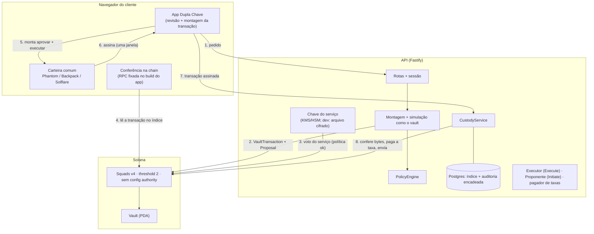

# Arquitetura

Custódia 2-de-2 na Solana. Os ativos ficam no Vault de uma multisig Squads v4. Os dois votantes são a **carteira comum do cliente** (Phantom, Backpack, Solflare…) e a **chave do serviço**, que só aprova o que passa pela política. Nenhuma chave isolada move fundos ou troca quem aprova: quem garante isso é o programa da Squads. O backend organiza o fluxo e aplica uma política *adicional*.

> Histórico: a primeira versão usava uma chave de aprovação gerada no próprio app, com PIN/biometria. A pedido do produto, em 2026-10-01 o modelo passou a usar a carteira que o cliente já tem. As decisões que mudaram estão marcadas com **(modelo atual)**.

## Diagrama



## Membros da multisig

| Papel | Permissão | Onde mora | O que consegue sozinho |
|---|---|---|---|
| Carteira do cliente | Vote + Execute | Phantom/Backpack/… do cliente | nada: 1 de 2 votos. Executar só roda o que já tem 2 votos. Não cria transações no Vault (sem Initiate) |
| Chave do serviço | Vote | KMS/HSM (dev: arquivo cifrado) | nada: 1 de 2 votos. Rejeitar (encerra uma proposta) |
| Executor do serviço | Execute | servidor | executar o que **já** tem 2 votos (rotações; reexecução) |
| Proponente do serviço | Initiate | servidor | criar propostas (spam, custo de rent) |

Configuração fixa: threshold 2, `config_authority = default` (multisig autônoma), `time_lock = 0`, sem `rent_collector`, sem spending limit. `assertStrictTwoOfTwo` confere tudo isso **na chain** antes de cada decisão do servidor e depois de cada troca de chave. Inclui as máscaras exatas: carteira 6, serviço 2.

## Fluxo de cadastro

1. O app descobre as carteiras pelo Wallet Standard e conecta a escolhida.
2. `GET /v1/wallets/:pk` diz se a carteira já tem conta. Se tiver, a carteira assina o texto de **entrada**; se não tiver, assina o texto de **vínculo**, e só uma janela abre.
3. Texto de vínculo, montado pelo servidor a partir do desafio que ele emitiu e mostrado pela própria carteira:
   ```
   Dupla Chave
   Vincular esta carteira a uma conta nova 2 de 2.

   Carteira: <chave pública>
   Conta: nova
   Rede: localnet
   Operação: ENROLL_CLIENT_KEY
   Desafio: <32 bytes hex>
   Válido até: <ISO>
   ```
4. O servidor remonta o texto esperado (nunca interpreta o recebido), confere a assinatura, gera uma chave nova do serviço e cria a multisig com a carteira (Vote+Execute), o serviço (Vote), o executor e o proponente.

## Fluxo de transação

1. **Pedido:** o app pede `TRANSFER_SOL {destino, valor}`.
2. **Montagem:** o backend lê a multisig na chain, confere o modelo 2-de-2, monta as instruções e a `TransactionIntent`. O hash da intenção é `sha256` do JSON canônico.
3. **Antes de propor:** política, conferência do destino (programa executável é recusado) e **simulação como o vault**. Se qualquer uma falhar, nada é criado na chain.
4. **Proposta + voto do serviço:** o proponente cria a VaultTransaction e a Proposal; o backend relê a conta criada, confere com a intenção e **o serviço vota**.
5. **Revisão no app:** o app lê pela RPC dele a multisig, a proposta (com o voto do serviço) e a transação no índice. Depois compara com a intenção recebida (`reviewOnChain`). Se divergir, mostra "Transação bloqueada" e não abre a carteira.
6. **Assinatura:** o app monta `[proposal_approve(carteira), vault_transaction_execute(carteira)]`, com o pagador do serviço e um blockhash recente. A carteira assina **uma vez**.
7. **Envio:** o backend compila a mensagem esperada e exige **bytes idênticos** aos assinados: nenhuma instrução, conta ou flag a mais. Depois confere a assinatura da carteira, assina como pagador e envia. Aprovar e executar é atômico: se a execução falhar, o voto também não fica.

Em mudanças de segurança (troca de carteira ou da chave do serviço), a carteira assina só `proposal_approve`. O executor do serviço executa e o backend confere o resultado na chain antes de atualizar o banco.

## Decisões de segurança

Cada decisão tem problema, alternativas, trade-off e decisão.

### D1. Rotação atômica

- **Problema:** o pedido original descrevia "adiciona a chave nova → confirma → remove a antiga". Entre os dois passos ficam 3 votantes com threshold 2: a carteira antiga + a nova, as duas do lado do usuário, movem fundos sem o servidor. O teste `PERIGO evitado` reproduz esse roubo no programa real.
- **Decisão:** usar uma ConfigTransaction `[AddMember(nova), RemoveMember(antiga)]`. O programa executa as ações em sequência e só verifica o invariant no fim, então nenhum estado intermediário existe na chain. A chave nova herda exatamente as permissões do papel (carteira 6, serviço 2); qualquer outra máscara faz a política recusar.

### D2. Aprovada pendente

- **Problema:** uma VaultTransaction aprovada continua executável depois que a configuração muda.
- **Decisão (modelo atual):** em operações, aprovar e executar vão na mesma transação, então "aprovada e não executada" não surge desse caminho. Em rotações, se o execute do executor falhar, a intenção vira `APPROVED_PENDING_EXECUTION`, a conta continua congelada e o app oferece "Executar de novo" ou "Cancelar". Cancelar exige a carteira + o serviço. Pedir uma rotação com aprovada pendente é recusado antes de congelar.

### D3. Expiração

- **Problema:** o programa não tem expiração de proposta.
- **Decisão:** toda intenção tem `expiresAt` (10 min para operação, 30 min para rotação). O app recusa montar a transação de uma intenção vencida. O backend recusa a transação assinada e o serviço **troca o voto para rejeição**: o programa remove a aprovação e, com cutoff 1, encerra a proposta. Um job faz o mesmo a cada 30 s, sob o mesmo lock das decisões.
- **Risco residual:** entre a expiração e o job, uma carteira com uma transação já assinada ainda executaria. A janela é de segundos e essa assinatura foi dada pelo próprio cliente.

### D4. Spending limits e config authority proibidos

Os dois criam caminhos que não passam pelo quórum. A política recusa `AddSpendingLimit`, `ChangeThreshold`, `SetTimeLock`, `SetRentCollector` e qualquer ConfigTransaction que não seja exatamente a rotação.

### D5. Bytes idênticos (modelo atual)

O app monta a transação da carteira; o backend recompila a mensagem esperada (mesmo pagador e blockhash) e exige os mesmos bytes. A primeira versão comparava instrução por instrução, mas ao compilar a mensagem as flags de conta passam a valer para a mensagem inteira. Comparar os bytes é mais simples e mais forte.

### D6. Conferência pelo app, com RPC fixada no build

O que impede "app mostra A, backend envia B" é o app ler a transação **pela RPC dele**. Essa RPC e o cluster são fixados no build (`VITE_RPC_URL`, `VITE_CLUSTER`) e nunca vêm da API: a revisão de 2026-10-01 provou o roubo quando vinham. Com `VITE_RPC_URL_2`, o app exige contas idênticas em duas RPCs.

### D7. Carteira do cliente (modelo atual)

- A chave é a da carteira que o cliente já usa. Ela nunca passa pelo app nem pelo backend: o app pede `signMessage` e `signTransaction` pelo Wallet Standard.
- O vínculo e o login são textos legíveis, que a carteira mostra na janela dela.
- Não há biblioteca de adapter: a descoberta pelo Wallet Standard tem cerca de 60 linhas. Cada dependência a menos é uma a menos na cadeia de suprimentos.
- Em localnet, as "Carteiras de teste" implementam a mesma interface: Ed25519 do WebCrypto, chave não exportável no IndexedDB, com janela de confirmação. Assim o fluxo é testável sem extensão.

### D8. Chave do servidor

`ServerSigner` expõe só `publicKey()` e `sign()`. Em dev, `DevFileKeyStore` guarda seeds cifradas com AES-256-GCM em arquivos 0600, ou só em memória. **A mainnet está bloqueada no `loadConfig`** até existir KMS/HSM. A chave nova do serviço precisa estar no provedor de chaves; uma chave do usuário nunca vira "chave do serviço".

### D9. Sessão não autoriza

A sessão (HMAC, 12 h) vem de a carteira assinar o texto de entrada ("Isto não aprova nenhuma transação"). Mover fundos exige a transação assinada pela carteira atual **na chain**. A sessão de uma carteira substituída morre junto com ela.

### D10. O banco é índice

Membros, threshold, propostas e status são relidos da chain antes de cada decisão. O status da proposta não é guardado.

### D11. Auditoria

Os eventos são encadeados por hash. A tabela tem trigger que recusa UPDATE/DELETE, e outro trigger impede reativar uma chave revogada.

### D12. Uma assinatura na carteira (modelo atual)

- **Problema:** a carteira comum mostra a transação de forma técnica: aprovar e executar uma proposta da Squads. Ela não mostra "enviar 2,5 SOL para X".
- **Alternativas:**
  - (a) Uma janela: aprovar + executar. O cliente confia na tela do app, que confere a chain.
  - (b) Duas janelas: a carteira assina antes um texto com o resumo, que ela mostra, e depois a transação.
- **Decisão (do produto):** (a), pela fluidez.
- **Risco residual:** um frontend adulterado pode pedir a assinatura de uma proposta que o cliente não quis. Mesmo assim, ela teria passado pela política do serviço (limites, lista de endereços, simulação). O endurecimento (b) é uma troca pequena: um texto `possessionMessage`-like com o resumo, verificado pelo backend antes de aceitar a transação. Ver THREAT_MODEL #24.

## Ambientes

| Variável | Uso |
|---|---|
| `SOLANA_RPC_URL` | RPC do backend |
| `VITE_RPC_URL`, `VITE_RPC_URL_2`, `VITE_CLUSTER` | RPC(s) e cluster do app, fixados no build |
| `SOLANA_CLUSTER` | `localnet` \| `devnet` (mainnet recusada nesta versão) |
| `SQUADS_PROGRAM_ID` | precisa ser igual ao do SDK |
| `DATABASE_URL` | Postgres; sem ela, memória |
| `DK_SESSION_SECRET`, `DK_ADMIN_TOKEN` | sessão e painel administrativo |
| `DK_KEY_ENCRYPTION_KEY`, `DK_KEYS_DIR` | "KMS" de desenvolvimento |
| `SURFPOOL_FORK=1` | `pnpm dev` com o surfpool como fork da mainnet (padrão: offline) |

## Fora desta entrega

Fica para depois:
- swap (Jupiter);
- tokens SPL no app;
- notificações reais;
- recuperação (RECOVERY.md);
- varredura de spending limits;
- ancoragem externa da auditoria;
- o endurecimento D12(b).
