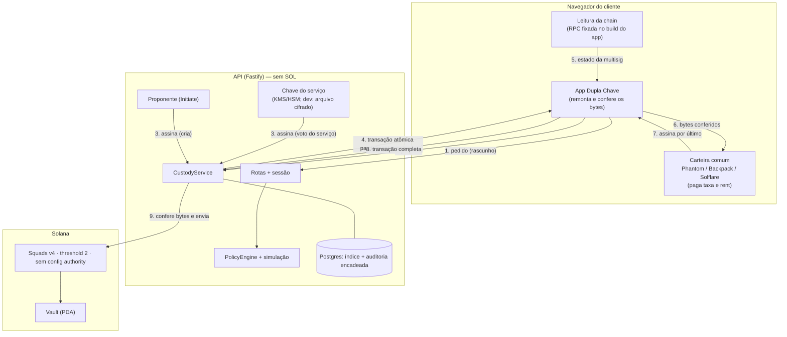

# Arquitetura

Custódia 2-de-2 na Solana. Os ativos ficam no Vault de uma multisig Squads v4. Os dois votantes são a **carteira comum do cliente** (Phantom, Backpack, Solflare…) e a **chave do serviço**, que só aprova o que passa pela política. Nenhuma chave isolada move fundos ou troca quem aprova: quem garante isso é o programa da Squads. O backend organiza o fluxo e aplica uma política *adicional*.

**O serviço não paga nada.** Taxa e rent saem da carteira do cliente, e cada operação é **uma transação atômica** que ela assina por último: criar, aprovar, executar e fechar.

> Histórico: a primeira versão usava uma chave de aprovação gerada no próprio app, com PIN/biometria. Em 2026-10-01 o modelo passou a usar a carteira que o cliente já tem. No mesmo dia, a pedido do produto ("não quero que o sistema pague pela transação"), passou a ser atômico e pago pela carteira. Antes, o proponente criava a proposta na chain, o serviço votava numa transação separada e o pagador do serviço pagava as taxas. As decisões que mudaram estão marcadas com **(modelo atual)**.

## Diagrama



## Membros da multisig

| Papel | Permissão | Onde mora | O que consegue sozinho |
|---|---|---|---|
| Carteira do cliente | Vote + Execute | Phantom/Backpack/… do cliente | nada: 1 de 2 votos. Executar só roda o que já tem 2 votos. Não cria transações no Vault (sem Initiate) |
| Chave do serviço | Vote | KMS/HSM (dev: arquivo cifrado) | nada: 1 de 2 votos |
| Proponente do serviço | Initiate | servidor | criar propostas (pagando o rent de outra conta: sozinho, nem isso) |
| Executor do serviço | Execute | servidor | executar o que **já** tem 2 votos. No modelo atual fica de reserva: quem executa é a carteira |

Configuração fixa: threshold 2, `config_authority = default` (multisig autônoma), `time_lock = 0`, `rent_collector = carteira do cliente`, sem spending limit. `assertStrictTwoOfTwo` confere tudo isso **na chain** antes de cada decisão do servidor e depois de cada troca de chave. Inclui as máscaras exatas: carteira 6, serviço 2.

## A transação atômica

```
[ vault_transaction_create(creator = proponente, rent_payer = carteira, memo = dk1:<hash da intenção>)
  proposal_create(creator = proponente, rent_payer = carteira)
  proposal_approve(serviço)
  proposal_approve(carteira)
  vault_transaction_execute(member = carteira)
  vault_transaction_accounts_close(rent_collector = carteira) ]
pagador: carteira · assinaturas: carteira, proponente, serviço
```

- O serviço e o proponente assinam **antes**, ao preparar. A carteira assina por último e paga. A assinatura do serviço cobre os bytes exatos da transação final: não serve para nenhuma outra.
- **Tudo ou nada.** Se a execução falha, nem a proposta fica na chain. Não existe "aprovada e não executada", proposta aberta ou proposta obsoleta.
- **Custo para a carteira:** a taxa de 3 assinaturas, 0,000015 SOL. O rent das duas contas, ~0,0056 SOL, é cobrado e devolvido na mesma transação: a carteira precisa *ter* ~0,0065 SOL na hora, mas não gasta. Medido em `tests/atomic.test.ts`. A transação tem 785 bytes; a da troca de carteira, 730.
- **Validade:** o blockhash vale ~60–90 s. Depois disso a transação preparada não entra mais (`PREPARED_WINDOW = 180 s`, com margem).
- **Multisig antiga sem `rent_collector`** (criada antes desta versão): a transação sai sem a instrução de fechar. O rent fica nas contas da proposta, e a próxima troca de carteira define o `rent_collector`.

## Fluxo de cadastro

1. O app descobre as carteiras pelo Wallet Standard e conecta a escolhida.
2. `GET /v1/wallets/:pk` diz se a carteira já tem conta. Se tiver, a carteira assina o texto de **entrada** (`signMessage`, de graça). Se não tiver, vai para o passo 3.
3. `POST /v1/enrollment/prepare`: o servidor gera uma chave nova do serviço e monta `[memo de vínculo assinado pela carteira, multisig_create_v2(creator = carteira)]`, com a carteira pagando e a `createKey` já assinada.
4. **O app confere a transação antes de a carteira assinar** (`verifyEnrollmentTransaction`), porque é ela que paga. Exige só essas duas instruções; threshold 2; esta carteira com máscara 6; um outro votante com 2; executor 4 e proponente 1; sem config authority nem time lock; e o rent voltando para ela. Uma transferência escondida da carteira é recusada.
5. A carteira assina (uma janela; ~0,003 SOL) e `POST /v1/enrollment/submit` confere os bytes e envia. A assinatura da carteira nessa transação é a prova de posse: sem ela, a conta não existe.

Cadastros que a carteira não assinou a tempo são descartados, junto com a chave do serviço gerada para eles.

## Fluxo de transação

1. **Rascunho:** `POST /v1/accounts/:id/intents` (`TRANSFER_SOL {destino, valor}`). O backend confere o modelo 2-de-2 na chain, a política, o destino (programa executável é recusado) e simula a transferência como o Vault. Nada vai para a chain.
2. **Preparar:** `POST /v1/intents/:id/prepare`. Sob o lock da conta, o backend:
   - concilia com a chain;
   - fixa o índice (`transaction_index + 1`) e, se ele mudou, sela a intenção de novo (mesmo id);
   - roda política e simulação outra vez e **simula a transação atômica inteira** (pega saldo insuficiente na carteira);
   - assina como serviço e proponente.
   A transação preparada fica em `IntentRecord.prepared` (lista: pode haver mais de uma válida ao mesmo tempo).
3. **Conferência no app** (`reviewPrepared`): o app lê a multisig **pela RPC dele** e confere o 2-de-2. Tira da chain o outro votante e o proponente (não do backend). Depois **remonta a transação sozinho** a partir da intenção que mostra na tela e compara os bytes. Também confere as assinaturas do serviço e do proponente. Se algo diverge, mostra "Transação bloqueada" com o que a transação recebida faria de verdade (`inspectPrepared` decodifica a mensagem embutida) e não abre a carteira.
4. **Assinatura:** a carteira assina **uma vez**. Se a preparação tiver mais de 40 s, o app prepara e confere de novo antes.
5. **Envio:** `POST /v1/intents/:id/submit`. O backend exige que a mensagem seja uma das preparadas e confere a assinatura da carteira. Então envia e marca EXECUTED.

Em mudanças de segurança (troca de carteira ou da chave do serviço), é a mesma coisa com uma ConfigTransaction: `config_transaction_execute` com a carteira atual como membro executor e `config_transaction_accounts_close`. O backend confere o 2-de-2 com a chave nova na chain antes de atualizar o banco.

### Conciliação

A chain manda. Uma transação preparada pode entrar sem passar pelo `submit`: o celular envia sozinho, ou o cliente recusou no app mas a carteira já tinha assinado. Por isso, antes de preparar e a cada 30 s (`expireDue`), o backend procura as transações preparadas na chain pela conta da transação da Squads (`signaturesFor` + bytes da mensagem):
- **entrou:** vira EXECUTED, mesmo se aqui estava recusada ou vencida, e uma troca de chave atualiza os registros;
- **não pode mais entrar** (índice usado por outra ou blockhash vencido): sai da lista.

Uma intenção com transação preparada ainda válida não vence até a janela passar.

## Fluxo pelo celular (Solana Pay)

1. O app pede um QR (`POST /v1/pay/connect`, `/v1/intents/:id/pay` ou `/v1/rotations/:id/pay-proof`) e mostra `solana:<URL HTTPS>/pay/<token>`.
2. A carteira do celular faz `GET` (rótulo e ícone) e depois `POST { account }`. O backend confere a carteira, monta a transação **paga por ela** (com as assinaturas do serviço e do proponente, quando é uma intenção) e devolve `{ transaction, message }`.
3. A carteira assina, paga e envia ela mesma. O backend acha a transação na chain pela conta que ela toca e compara os bytes com a preparada:
   - **intenção:** a transação da Squads no índice;
   - **cadastro:** a multisig;
   - **entrada / prova de posse:** a própria carteira.
4. O computador acompanha por `GET /v1/pay/:token` e segue sozinho. Em cadastro ou entrada, ele recebe a sessão.

O Solana Pay não tem `signMessage`, então entrada e prova de posse viram transações com memo, pagas pela carteira (0,000005 SOL cada). A carteira nova, na troca, precisa desse pouquinho de SOL.

## Decisões de segurança

Cada decisão tem problema, alternativas, trade-off e decisão.

### D1. Rotação atômica

- **Problema:** o pedido original descrevia "adiciona a chave nova → confirma → remove a antiga". Entre os dois passos ficam 3 votantes com threshold 2: a carteira antiga + a nova, as duas do lado do usuário, movem fundos sem o servidor. O teste `PERIGO evitado` reproduz esse roubo no programa real.
- **Decisão:** usar uma ConfigTransaction `[AddMember(nova), RemoveMember(antiga)]`, mais `SetRentCollector(nova)` na troca da carteira. O programa executa as ações em sequência e só verifica o invariant no fim, então nenhum estado intermediário existe na chain. A chave nova herda exatamente as permissões do papel (carteira 6, serviço 2); qualquer outra máscara faz a política recusar.

### D2. Aprovada pendente (modelo atual)

- **Problema:** uma VaultTransaction aprovada continua executável depois que a configuração muda.
- **Decisão:** criar, aprovar e executar vão na mesma transação. "Aprovada e não executada" deixa de existir, e com ela o congelamento das operações durante uma troca de chave, a drenagem da fila e o "executar de novo / cancelar". Uma operação e uma troca preparadas no mesmo índice não colidem: só uma entra, e a outra é preparada de novo no índice seguinte.

### D3. Expiração (modelo atual)

- **Problema:** o programa não tem expiração de proposta.
- **Decisão:** a intenção tem `expiresAt` (10 min para operação, 30 min para rotação), e o app e o backend recusam preparar ou assinar depois disso. A transação preparada expira sozinha com o blockhash (~60–90 s). Não há voto para trocar nem proposta para rejeitar: nada foi para a chain.
- **Risco residual:** recusar no app depois que a carteira assinou não desfaz a assinatura. Se a carteira enviar dentro da janela do blockhash, a transação executa, e a conciliação registra. A assinatura foi do próprio cliente.

### D4. Spending limits e config authority proibidos

Os dois criam caminhos que não passam pelo quórum. A política recusa `AddSpendingLimit`, `RemoveSpendingLimit`, `ChangeThreshold`, `SetTimeLock` e qualquer ConfigTransaction que não seja exatamente a rotação. `SetRentCollector` só é aceito dentro da troca da carteira, apontando para a nova.

### D5. Bytes idênticos (modelo atual)

Servidor e app usam a mesma função (`atomicInstructionsFor`) para montar a transação a partir da intenção e do estado da chain. O app compara os bytes da mensagem recebida com os da que ele montou. O backend compara a transação assinada com as que preparou. A primeira versão comparava instrução por instrução, mas ao compilar a mensagem as flags de conta passam a valer para a mensagem inteira. Comparar os bytes é mais simples e mais forte.

### D6. Conferência pelo app, com RPC fixada no build

O app lê a multisig **pela RPC dele**. Essa RPC e o cluster são fixados no build (`VITE_RPC_URL`, `VITE_CLUSTER`) e nunca vêm da API: a revisão de 2026-10-01 provou o roubo quando vinham. Com `VITE_RPC_URL_2`, o app exige contas idênticas em duas RPCs. No modelo atual, o app ainda remonta a transação inteira: um backend que mente sobre o outro votante ou o proponente não passa, porque os dois vêm da chain.

### D7. Carteira do cliente (modelo atual)

- A chave é a da carteira que o cliente já usa. Ela nunca passa pelo app nem pelo backend: o app pede `signMessage` e `signTransaction` pelo Wallet Standard. `signTransaction` mantém as assinaturas que o serviço já pôs.
- O login é um texto legível, que a carteira mostra na janela dela. O cadastro é a própria criação da conta, com um memo de vínculo.
- Não há biblioteca de adapter: a descoberta pelo Wallet Standard tem cerca de 60 linhas. Cada dependência a menos é uma a menos na cadeia de suprimentos.
- Em localnet, as "Carteiras de teste" implementam a mesma interface: Ed25519 do WebCrypto, chave não exportável no IndexedDB, com janela de confirmação. Assim o fluxo é testável sem extensão. O app pede SOL de teste para elas antes do cadastro.

### D8. Chave do servidor

`ServerSigner` expõe só `publicKey()` e `sign()`. Em dev, `DevFileKeyStore` guarda seeds cifradas com AES-256-GCM em arquivos 0600, ou só em memória. **A mainnet está bloqueada no `loadConfig`** até existir KMS/HSM. A chave nova do serviço precisa estar no provedor de chaves; uma chave do usuário nunca vira "chave do serviço".

### D9. Sessão não autoriza

A sessão (HMAC, 12 h) vem de a carteira assinar o texto de entrada ("Isto não aprova nenhuma transação"). Mover fundos exige a transação assinada pela carteira atual **na chain**. A sessão de uma carteira substituída morre junto com ela.

### D10. O banco é índice

Membros, threshold e índice são relidos da chain antes de cada decisão; o que entrou na chain é conciliado. O status da proposta não existe mais: ela é criada e fechada na mesma transação.

### D11. Auditoria

Os eventos são encadeados por hash. A tabela tem trigger que recusa UPDATE/DELETE, e outro trigger impede reativar uma chave revogada.

### D12. Uma assinatura na carteira

- **Problema:** a carteira comum mostra a transação de forma técnica, como instruções da Squads. Ela não mostra "enviar 2,5 SOL para X".
- **Alternativas:**
  - (a) Uma janela: a transação atômica. O cliente confia na tela do app, que remonta os bytes.
  - (b) Duas janelas: a carteira assina antes um texto com o resumo, que ela mostra, e depois a transação.
- **Decisão (do produto):** (a), pela fluidez.
- **Risco residual:** um frontend adulterado pode pedir a assinatura de uma operação que o cliente não quis. Mesmo assim, ela teria passado pela política do serviço (limites, lista de endereços, simulação). O endurecimento (b) é uma troca pequena: um texto com o resumo, verificado pelo backend antes de aceitar a transação. Ver THREAT_MODEL #24.

### D13. Quem paga (modelo atual)

- **Problema:** o serviço pagava taxa e rent de tudo (cadastro, propostas, votos, execução). Isso custa dinheiro por cliente e cria um alvo: quem consegue sessões consegue gastar o SOL do serviço.
- **Alternativas:**
  - (a) Serviço paga tudo (antes).
  - (b) Carteira paga, em várias transações: proponente cria, serviço vota, carteira aprova e executa. Ainda sobra o serviço pagando a taxa do próprio voto, e volta o estado pendente.
  - (c) Carteira paga, numa transação atômica, com o serviço pré-assinando.
- **Decisão:** (c). O serviço fica sem SOL nenhum, nada fica pendente na chain e a assinatura do serviço só vale para aqueles bytes.
- **Custos:**
  - o cliente precisa de SOL na carteira: ~0,003 SOL uma vez para criar a conta; ~0,0065 SOL de saldo na hora de cada transação, com custo real de 0,000015;
  - entrar pelo celular custa 0,000005 SOL, porque o Solana Pay não tem `signMessage`;
  - a carteira nova, na troca pelo celular, precisa de 0,000005 SOL para a prova.

## Ambientes

| Variável | Uso |
|---|---|
| `SOLANA_RPC_URL` | RPC do backend |
| `VITE_RPC_URL`, `VITE_RPC_URL_2`, `VITE_CLUSTER` | RPC(s) e cluster do app, fixados no build |
| `SOLANA_CLUSTER` | `localnet` \| `devnet` (mainnet recusada nesta versão) |
| `SQUADS_PROGRAM_ID` | precisa ser igual ao do SDK |
| `DATABASE_URL` | Postgres; sem ela, memória |
| `DK_SESSION_SECRET`, `DK_ADMIN_TOKEN` | sessão e painel administrativo |
| `DK_KEY_ENCRYPTION_KEY`, `DK_KEYS_DIR` | "KMS" de desenvolvimento |
| `DK_PUBLIC_URL` | URL HTTPS que o celular alcança (QR do Solana Pay) |
| `SURFPOOL_FORK=1` | `pnpm dev` com o surfpool como fork da mainnet (padrão: offline) |

## Fora desta entrega

Fica para depois:
- swap (Jupiter);
- tokens SPL no app;
- notificações reais;
- recuperação (RECOVERY.md);
- varredura de spending limits;
- ancoragem externa da auditoria;
- o endurecimento D12(b);
- cadastros pendentes sobrevivendo a reinício da API (hoje ficam em memória por ~3 min).
