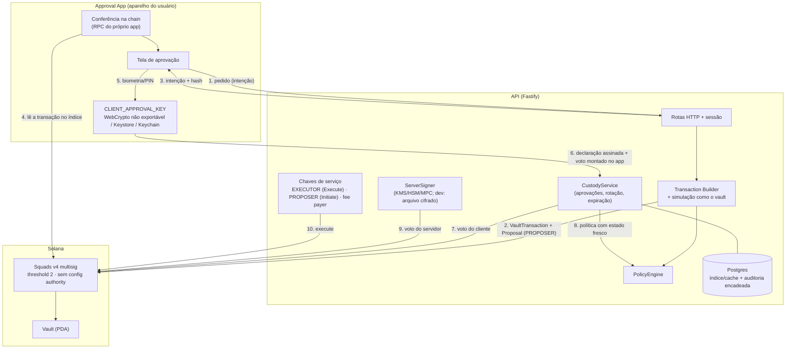

# Arquitetura

O objetivo é um "2FA criptográfico on-chain": os ativos ficam no Vault de uma multisig Squads v4 2-de-2, e nenhuma chave isolada — do usuário, do servidor, do executor ou da wallet operacional — move fundos ou troca quem aprova. Quem garante isso é o programa da Squads; o backend só organiza o fluxo e aplica uma política *adicional*.

## Diagrama



O texto do pedido original previa o fluxo `USER → wallet operacional → API`. Nesta entrega o próprio Approval App faz o pedido, e quem cria a proposta é uma chave `PROPOSER` (só Initiate) do serviço — a "wallet operacional" em modo relayer. Uma wallet operacional do usuário (Phantom etc.) pode ser adicionada como segundo membro Initiate sem mudar nada na segurança: Initiate não vota.

## Membros da multisig

| Papel | Permissão | Onde mora | O que consegue sozinho |
|---|---|---|---|
| CLIENT_APPROVAL_KEY | Vote | aparelho do usuário | nada: 1 de 2 votos; rejeitar (encerra uma proposta) |
| SERVER_APPROVAL_KEY | Vote | KMS/HSM (dev: arquivo cifrado) | nada: 1 de 2 votos; rejeitar |
| EXECUTOR | Execute | servidor | executar o que **já** tem 2 votos — escolhe só o momento |
| PROPOSER (wallet operacional) | Initiate | servidor | criar propostas (spam, custo de rent) |

Threshold 2, `config_authority = default` (autônoma), `time_lock = 0`, sem `rent_collector`, sem spending limit. `assertStrictTwoOfTwo` confere tudo isso **na chain** antes de qualquer decisão do servidor e depois de cada rotação.

## Pacotes

```
packages/shared         intenção canônica (JSON canônico + sha256), schemas zod, SecurityError
packages/crypto         Signer/ServerSigner, declarações off-chain assinadas (prefixo 0xFF)
packages/solana         Chain (RPC | LiteSVM), leitor de instruções System/Token/ATA
packages/squads         estado on-chain, construtores, invariantes, derivação da intenção a partir da chain
packages/policy-engine  PolicyEngine + DefaultPolicyEngine
packages/custody        CustodyService (servidor) e client.ts (app): revisão na chain, assinatura
packages/database       PgStore (Postgres/PGlite) + migração SQL
apps/api                Fastify: rotas, sessão, chaves de dev, expiração periódica
apps/approval-web       Approval App (React, WebCrypto Ed25519 não exportável)
```

`packages/custody/src/client.ts` e `display.ts` não dependem de Node: são o mesmo código no app web e serão o mesmo no app nativo.

## Fluxo de uma operação

1. **Intenção**: o app pede `TRANSFER_SOL {destino, valor}`. O backend lê a multisig na chain e confere o modelo 2-de-2.
2. **Construção**: monta as instruções, monta a `TransactionIntent` (tipo, vault, valor, destino, programas, índice, cluster, criação, validade) e calcula `intentHash = sha256(JSON canônico)`.
3. **Antes de propor**: política com a visão reconstruída dos bytes, conferência do destino (programa executável é recusado; conta de outro programa é marcada) e **simulação como o vault** (`simulateTransaction` sem verificação de assinatura). Falhou em qualquer um → nada é criado na chain.
4. **Proposta**: `vaultTransactionCreate + proposalCreate` numa transação, assinada pelo PROPOSER. O backend relê a conta criada e confere que ela corresponde à intenção.
5. **Revisão no app**: o app lê pela **RPC dele** a multisig, a proposta e a transação no índice; reconstrói o que a transação faz e compara com a intenção recebida (`reviewOnChain`). Divergência → tela "Transação bloqueada", nada é assinado.
6. **Assinatura**: depois da biometria/PIN, o app assina (a) uma declaração off-chain e (b) o voto `proposal_approve` que **ele mesmo monta** (não assina bytes recebidos do servidor).
7. **Servidor**: confere a declaração (campos, validade, assinante = CLIENT atual **na chain**, hash da conta on-chain, nonce de uso único), confere que o voto é exatamente `proposal_approve(multisig, índice, cliente, memo)`, paga a taxa e envia. Roda a política de novo com estado fresco. Só então assina o próprio voto.
8. **Execução**: o EXECUTOR executa. Se falhar, a intenção fica `FAILED` e um evento de segurança registra "aprovada e não executada" (ela continua executável e bloqueia rotações até ser executada ou cancelada).

### A declaração assinada pelo cliente

```json
{
  "domain": "duplachave/approval/v1",
  "decision": "APPROVE",
  "cluster": "localnet",
  "multisig": "…",
  "transactionIndex": "7",
  "transactionKind": "VAULT",
  "intentId": "uuid",
  "intentHash": "sha256 da intenção canônica",
  "transactionHash": "sha256 dos bytes da conta VaultTransaction lida da chain",
  "signer": "chave do cliente",
  "nonce": "16 bytes aleatórios",
  "createdAt": 1790822851,
  "expiresAt": 1790823151
}
```

Bytes assinados: `0xFF || "duplachave/v1\n" || JSON canônico`. O `0xFF` inicial garante que a declaração nunca é uma mensagem de transação Solana válida (legacy começa com o número de assinaturas < 0x80; versionada com `0x80 | versão`, e só a v0 existe) — a mesma técnica do padrão off-chain da Solana. Sem isso, um servidor malicioso poderia pedir ao app para "assinar uma declaração" que na verdade é uma transação.

Vínculos: multisig + índice + intentHash + hash da conta on-chain + validade + nonce. Mudar qualquer campo invalida a assinatura; reusar a declaração esbarra no nonce consumido (tabela `consumed_nonces`, inserção atômica).

## Decisões de segurança

Cada decisão: problema, alternativas, trade-off, decisão.

### D1. Rotação atômica

- **Problema**: o pedido descrevia "adiciona CLIENT_B → confirma → remove CLIENT_A". Entre os dois passos há 3 votantes com threshold 2: CLIENT_A + CLIENT_B — os dois do lado do usuário — movem fundos sem o servidor. Fere a invariante 4. O teste `PERIGO evitado` reproduz o roubo no programa real.
- **Alternativas**: (a) dois passos; (b) subir o threshold para 3 durante a troca (exige três votos no passo de remoção e ainda deixa uma janela); (c) uma ConfigTransaction `[AddMember(B), RemoveMember(A)]`.
- **Decisão**: (c). O programa executa as ações em sequência e só verifica o invariant no fim; nenhum estado intermediário existe na chain. A máquina de estados do pedido foi mantida com `EXECUTING` no lugar de `ADDING_NEW_MEMBER/REMOVING_OLD_MEMBER` (KEY_ROTATION.md).

### D2. Aprovada pendente bloqueia a rotação

- **Problema**: VaultTransaction aprovada continua executável depois que a configuração muda (item 6 da pesquisa). Uma aprovação feita com a chave antiga sobreviveria à troca.
- **Alternativas**: executar antes; cancelar antes (exige os dois); deixar e cancelar depois com a chave nova.
- **Decisão**: o executor executa imediatamente após o segundo voto, então "aprovada e não executada" só existe se a execução falhou. A rotação drena a fila: rejeita propostas ativas (um voto basta) e, se encontrar aprovada pendente, para em `ROLLBACK_REQUIRED` pedindo execução ou cancelamento (CLIENT + SERVER). Depois da rotação, CLIENT_B + SERVER também conseguem cancelar (teste).

### D3. Expiração

- **Problema**: não há expiração on-chain.
- **Decisão**: toda intenção tem `expiresAt` (10 min para operação, 30 min para rotação). O app recusa assinar vencida; o servidor recusa a declaração e **rejeita a proposta on-chain** (cutoff 1); um job a cada 30 s faz o mesmo para pendências esquecidas. Risco residual: entre o segundo voto e a execução não há prazo — mitigado por executar na hora.

### D4. Spending limits e config authority proibidos

Os dois criam caminhos que não passam pelo quórum (item 3 e 4 da pesquisa). A política recusa `AddSpendingLimit`, `ChangeThreshold`, `SetTimeLock`, `SetRentCollector` e qualquer ConfigTransaction que não seja exatamente a rotação. Como não há config authority, um spending limit só nasceria de uma ConfigTransaction aprovada pelos dois. Pendente para produção: varrer contas `SpendingLimit` da multisig via `getProgramAccounts` no monitoramento.

### D5. O app nunca assina bytes que não montou

O voto do cliente é `proposal_approve(multisig, índice, cliente, memo)` montado no app com o pagador e o blockhash informados pelo servidor. O servidor confere que é exatamente essa instrução antes de pagar a taxa. Sem isso, um servidor malicioso poderia entregar ao app um voto para outro índice.

### D6. Conferência pelo app, com RPC própria

O que impede "app mostra A, backend envia B" é o app ler a transação **pela RPC dele**. Em dev o `/rpc` do app e a API apontam para o mesmo surfpool; em produção o app deve usar outro provedor (ou dois, comparando), senão um backend comprometido que também controle a RPC poderia mentir para os dois lados. Ver THREAT_MODEL.md, "RPC malicioso".

### D7. Chave do cliente

- Navegador (esta entrega): WebCrypto Ed25519, `extractable: false`, `CryptoKey` no IndexedDB. Confirmação local por biometria (WebAuthn, `userVerification: required`) ou PIN de 6 dígitos (PBKDF2-SHA256, 310 mil iterações; 5 erros travam 5 min). O signer só assina por 20 s depois da confirmação.
- Limite honesto: a confirmação por WebAuthn/PIN é uma trava da interface, não um vínculo criptográfico com a chave Ed25519 (malware com controle do processo do navegador pode chamar `sign`). Em dispositivo nativo a trava é do sistema: Keystore com `setUserAuthenticationRequired` ou Keychain com `biometryCurrentSet`.
- App nativo (próxima fase): interface `Signer` igual; Android com Ed25519 no Keystore (TEE, Android 13+, KeyMint ≥ 2) e fallback para seed cifrada; iOS com seed no Keychain protegida por biometria (o Secure Enclave não tem Ed25519). Passkey, MPC ou hardware signer entram como outras implementações de `Signer` — passkey só via programa intermediário, porque o v4 exige signer Ed25519.

### D8. Chave do servidor

`ServerSigner` expõe só `publicKey()` e `sign()`. Em dev, `DevFileKeyStore` guarda seeds cifradas com AES-256-GCM em arquivos 0600 (ou só memória). **Mainnet está bloqueada no `loadConfig`** até existir KMS/HSM. A chave antiga é aposentada (`retire`) depois de removida on-chain.

### D9. Sessão não autoriza

A sessão HTTP (HMAC, 12 h) identifica quem chama. Toda decisão exige a declaração assinada pela CLIENT key atual na chain. Uma sessão de chave revogada morre junto (o middleware confere que a chave da sessão ainda é a CLIENT da conta). Teste: "sessão não substitui assinatura".

### D10. O banco é índice

Membros, threshold, propostas e status são relidos da chain antes de cada decisão. A tabela `squads_transactions` guarda endereço e hash do que foi criado; **o status da proposta não é guardado** (sempre vem da chain). O banco guarda o que a chain não tem: intenções, declarações assinadas (evidência), nonces consumidos, rotações e auditoria.

### D11. Auditoria

Eventos encadeados por hash (`prev_hash → hash`), tabela com trigger que recusa UPDATE/DELETE, e trigger que impede reativar chave revogada. Em produção o usuário da aplicação não deve ter permissão de `ALTER`/`TRUNCATE`/`DROP TRIGGER`, e o último hash deve ser ancorado fora (log externo ou memo on-chain periódico).

## Ambientes

| Variável | Uso |
|---|---|
| `SOLANA_RPC_URL` | RPC do backend |
| `APP_RPC_URL` | RPC que o app usa para conferir (padrão `/rpc`, proxy de dev) |
| `SOLANA_CLUSTER` | `localnet` \| `devnet` (mainnet recusada nesta versão) |
| `SQUADS_PROGRAM_ID` | precisa ser igual ao do SDK, senão a API não sobe |
| `DATABASE_URL` | Postgres; sem ela, memória |
| `DK_SESSION_SECRET`, `DK_ADMIN_TOKEN` | sessão e painel administrativo |
| `DK_KEY_ENCRYPTION_KEY`, `DK_KEYS_DIR` | "KMS" de desenvolvimento |

## Fora desta entrega

Swap (Jupiter), tokens SPL no app (o backend e o leitor já entendem TransferChecked), notificações reais (há `NotificationService` com mock), app nativo, recuperação (RECOVERY.md), varredura de spending limits, ancoragem externa da auditoria, rate limit por usuário.
